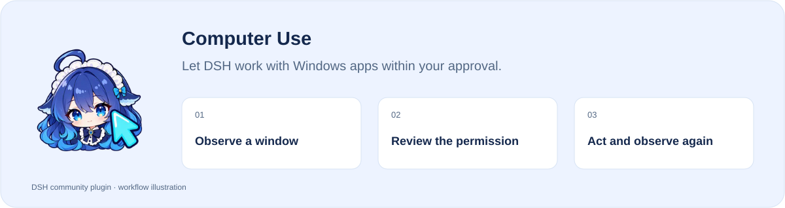

[简体中文](README.md) · **English**

# Computer Use

> **Let DeepSeek Harness observe and automate Windows apps strictly within your approval.**

Windows 10/11 desktop automation plugin & native **Computer Use** sidebar workbench for DeepSeek Harness (`>=0.2.2-rc.3`) with UIA control trees, DPI-guarded coordinates, per-app consent, audit logs, and hot-reload teardown.

[](https://www.npmjs.com/package/deepseek-computer-use) [](https://www.npmjs.com/package/deepseek-computer-use) [](https://www.npmjs.com/package/deepseek-computer-use)

**[Features](#features) · [Install](#install) · [Workflow](#start-using-it) · [Full guide](https://github.com/STARDUSTLC666/deepseek-computer-use/blob/main/docs/REFERENCE.en.md)**

<picture>
  <source media="(prefers-color-scheme: dark) and (max-width: 640px)" srcset="https://raw.githubusercontent.com/STARDUSTLC666/deepseek-computer-use/main/docs/assets/intro/workflow-en-mobile-dark.svg">
  <source media="(max-width: 640px)" srcset="https://raw.githubusercontent.com/STARDUSTLC666/deepseek-computer-use/main/docs/assets/intro/workflow-en-mobile-light.svg">
  <source media="(prefers-color-scheme: dark)" srcset="https://raw.githubusercontent.com/STARDUSTLC666/deepseek-computer-use/main/docs/assets/intro/workflow-en-dark.svg">
  
</picture>

## Features

| Pillar | Capabilities |
| :--- | :--- |
| **Computer Use Workbench** | Inspect window snapshots, numbered UIA controls, and capture timings side by side across 4 layouts sharing Suite themes, with 1-click consent revocation |
| **DPI-Safe Capture & Input** | Full/cropped (`region`) screenshots or text-only UIA mode; relative client-area thousandths (`0..999`) track movement and return `WINDOW_CHANGED` on resize/DPI shift |
| **17 Tools + TS PTC Bridge** | Default `hybrid` mode exposes 17 flat tools + CUA objects (`hybrid`/`tools`/`cua`), plus `cua_run_code` when TypeScript PTC is active |
| **Granular Consent & Audit** | Grant session, persistent, or denied access per app; full action audit trail and instant helper/cursor teardown on cancellation |

### Direct Slash Commands

| Command | Action |
| :--- | :--- |
| `/cu status` | Inspect Computer Use status and capture diagnostics |
| `/cu stop` | Stop Computer Use for the active turn immediately |
| `/cu restore-cursor` | Restore the system cursor state |
| `/cu revoke <app name or ID>` | Revoke automation access for an application |

## Install

Open **Plugins** in the Windows 10/11 DSH desktop app and install `deepseek-computer-use`, or use the CLI:

```bash
dsh plugin --profile desktop add deepseek-computer-use
```

For the web profile, replace `desktop` with `web` and restart DSH. Requires DSH `>=0.2.2-rc.3` (standalone companion plugin, not bundled in `dsh-suite`).

## Start using it

1. **Open the target app**: Start a Windows 10/11 DSH session and describe the app, goal, and allowed scope.
2. **Approve & observe first**: Grant app access when prompted, then inspect screenshots or UIA controls before clicking or typing.
3. **Verify & stay in control**: Review sensitive confirmations, re-observe after uncertain steps, and use `/cu stop` or cancel anytime.

### Example prompt

> Inspect the target app window and controls, then explain the next step without clicking or typing.

## Before you start

- Windows 10/11 only; app privilege boundaries and UIA support affect what can be automated.
- Windows `csc.exe` builds the native helper and cursor overlay into a source-hashed cache; WGC/WASAPI are optional while PrintWindow and BitBlt work out of the box.
- Full configuration, tools, and troubleshooting: [full reference](https://github.com/STARDUSTLC666/deepseek-computer-use/blob/main/docs/REFERENCE.en.md).

## Plugin updates

Check updates at the bottom of the workbench or native plugin details. Automatic checks are on by default; **automatic installation is off**.

## Documentation & feedback

- [Full usage, configuration and limits](https://github.com/STARDUSTLC666/deepseek-computer-use/blob/main/docs/REFERENCE.en.md) · [Release notes](https://github.com/STARDUSTLC666/deepseek-computer-use/blob/main/CHANGELOG.md)
- Stars, [Issues](https://github.com/STARDUSTLC666/deepseek-computer-use/issues), and [PRs](https://github.com/STARDUSTLC666/deepseek-computer-use/pulls) are welcome (strip credentials first).

## License

[MIT](https://github.com/STARDUSTLC666/deepseek-computer-use/blob/main/LICENSE)

<a id="use"></a>
<a id="updates"></a>
<a id="documentation-and-feedback"></a>
