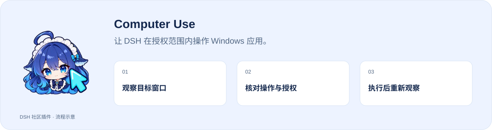

**简体中文** · [English](README.en.md)

# Computer Use

> **让 DeepSeek Harness 在明确授权范围内观察并操作 Windows 桌面应用。**

Windows 10/11 桌面自动化插件与原生 **「电脑控制」工作台**（DSH `>=0.2.2-rc.3`）：提供窗口截图、UIA 控件树、千分比精准键鼠、会话级应用授权、操作审计与热重载进程回收。

[](https://www.npmjs.com/package/deepseek-computer-use) [](https://www.npmjs.com/package/deepseek-computer-use) [](https://www.npmjs.com/package/deepseek-computer-use)

**[核心能力](#核心能力) · [安装](#安装) · [快速上手](#开始使用) · [完整说明](https://github.com/STARDUSTLC666/deepseek-computer-use/blob/main/docs/REFERENCE.zh.md)**

<picture>
  <source media="(prefers-color-scheme: dark) and (max-width: 640px)" srcset="https://raw.githubusercontent.com/STARDUSTLC666/deepseek-computer-use/main/docs/assets/intro/workflow-zh-mobile-dark.svg">
  <source media="(max-width: 640px)" srcset="https://raw.githubusercontent.com/STARDUSTLC666/deepseek-computer-use/main/docs/assets/intro/workflow-zh-mobile-light.svg">
  <source media="(prefers-color-scheme: dark)" srcset="https://raw.githubusercontent.com/STARDUSTLC666/deepseek-computer-use/main/docs/assets/intro/workflow-zh-dark.svg">
  
</picture>

## 核心能力

| 模块 | 核心特性 |
| :--- | :--- |
| **「电脑控制」原生工作台** | 并排查看窗口快照、编号 UIA 控件树与抓屏耗时；提供 4 种布局并与 Suite 共用皮肤，随时管理与撤销应用授权 |
| **精准观测与防漂移键鼠** | 支持窗口/局部区域（`region`）截图与纯文本 UIA 模式；指针支持客户区千分比相对坐标（`0..999`），窗口缩放或 DPI 变化时返回 `WINDOW_CHANGED` 防误点 |
| **17 工具 + TS PTC 编排** | 默认混合模式暴露 17 个平铺工具与 CUA 对象桥接（`exposeMode`: `hybrid`/`tools`/`cua`），已挂载 TS PTC 时支持 `cua_run_code` |
| **会话授权与即时中断** | 按应用细粒度选择本会话允许、始终允许或拒绝；全流程保留操作审计，取消任务即刻终止原生 Helper 并恢复系统光标 |

### 直控斜杠命令

| 命令 | 作用 |
| :--- | :--- |
| `/cu status` | 查看当前电脑控制状态与抓屏链路诊断 |
| `/cu stop` | 立即停止当前轮次的桌面控制 |
| `/cu restore-cursor` | 恢复系统光标状态 |
| `/cu revoke <应用名或 ID>` | 立即撤销指定应用的桌面控制授权 |

## 安装

在 Windows 10/11 的 DSH 桌面版「插件」面板安装 `deepseek-computer-use`，或使用命令行：

```bash
dsh plugin --profile desktop add deepseek-computer-use
```

网页版将 `desktop` 改为 `web`，安装后重启 DSH。宿主要求：`>=0.2.2-rc.3`（独立配套插件，不在 `dsh-suite` 18 件套内）。

## 开始使用

1. **打开目标软件并声明范围**：安装后开启新会话，打开要操作的 Windows 应用并说明目标与允许范围。
2. **批准应用授权并先观察**：按提示授权该应用；先让助手截图或读取控件树，再执行点击与输入。
3. **核对敏感动作与结果**：敏感步骤先审后做；如遇失败先重新观测避免重复提交，随时可用 `/cu stop` 或取消任务中断。

### 常用对话示例

> 先查看目标应用的窗口和控件，说明下一步计划，暂不点击或输入。

## 开始前要知道

- 仅面向 Windows 10/11；应用权限级别、UIA 控件支持度与桌面环境会影响可自动化范围。
- Helper 与光标覆盖层首次使用时由系统 `csc.exe` 按源码哈希缓存编译；WGC/WASAPI 可单独构建，常规抓屏支持 PrintWindow 与 BitBlt。
- 详细配置、完整工具与排错见 [完整说明](https://github.com/STARDUSTLC666/deepseek-computer-use/blob/main/docs/REFERENCE.zh.md)。

## 插件更新

在工作台或原生插件详情页底部检查更新（支持并发探测 npmjs 与 npmmirror）。默认自动检查，**默认不自动安装**。

## 文档与反馈

- [完整使用、配置与边界](https://github.com/STARDUSTLC666/deepseek-computer-use/blob/main/docs/REFERENCE.zh.md) · [更新记录](https://github.com/STARDUSTLC666/deepseek-computer-use/blob/main/CHANGELOG.md)
- 欢迎 Star、提交 [Issues](https://github.com/STARDUSTLC666/deepseek-computer-use/issues) 与 [PR](https://github.com/STARDUSTLC666/deepseek-computer-use/pulls)（反馈请附版本与复现步骤，并移除凭据）。

## License

[MIT](https://github.com/STARDUSTLC666/deepseek-computer-use/blob/main/LICENSE)

<a id="自检"></a>
<a id="deepseek-harness-接入"></a>
<a id="它解决什么问题"></a>
<a id="架构"></a>
<a id="工具"></a>
<a id="使用中指示器对齐-codex-的两个-overlay"></a>
<a id="安全模型"></a>
<a id="配置"></a>
<a id="与-codex-windows-window2-的关系"></a>
<a id="能力边界"></a>
<a id="抓屏链路对齐-codex-的-wgc"></a>
<a id="已知限制"></a>
<a id="测试"></a>
<a id="许可"></a>
<a id="原生载荷nativebin"></a>
<a id="与-codex-window2-的细节对齐第二轮"></a>
<a id="配置示例"></a>
<a id="已知边界"></a>
